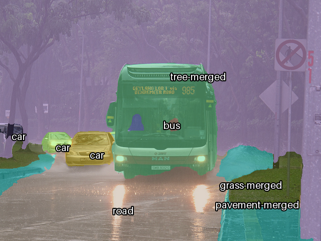

# DETR-PS: panoptic segmentation with DETR

A 2023 Northeastern deep learning course project by Anush Sriram Ramesh and Aryaman Patel. We adapted Facebook's [DETR](https://github.com/facebookresearch/detr) panoptic model to fine-tune on Cityscapes, starting from the COCO weights.

In 2026 I got the code running again on current PyTorch and checked it against DETR's published COCO results.



*Output from this repo with the official COCO weights. Input: COCO val2017 [000000084170](http://images.cocodataset.org/val2017/000000084170.jpg), [Flickr](http://farm9.staticflickr.com/8190/8134254727_0b28cabe93_z.jpg), CC BY.*

## Results

The official `detr-r50-panoptic` weights, run through this repo's model code on all 5,000 COCO panoptic val2017 images:

| | PQ | SQ | RQ |
|---|---|---|---|
| This repo | 43.5 | 79.3 | 53.9 |
| Published | 43.4 | 79.3 | 53.8 |

These are the original authors' weights, so the match shows the code is correct. It isn't a new result.

Speed on an RTX 5080, one image at a time, 800 px short side:

| | Median time | Rate |
|---|---|---|
| Forward pass | 46 ms | 21.7 FPS |
| With panoptic post-processing | 59 ms | 16.8 FPS |

Peak VRAM allocated was 3.0 GB.

## What this repo is

Most of the code is DETR's. `models/`, `utils/hungarianMatcher.py` and `utils/utils.py` are 97-100% identical to upstream, split across different files.

What the project added:

- A Cityscapes panoptic dataset class (`data/dataloader.py`).
- A fine-tuning setup that reuses the COCO weights, trains a new 34-class head and freezes the attention layers (`training/config.py`).
- W&B logging and a per-class PQ/SQ/RQ chart (`evaluation/evaluator.py`).

What the 2026 revival changed:

- Added the imports that were missing from most modules. As committed in 2023, the files could not be imported.
- Replaced the `torch.hub` model download with loading the checkpoint directly.
- Made the Cityscapes path configurable with `CITYSCAPES_ROOT`.
- Added `tools/` for reproducing the numbers above.

## Limitations

- **No Cityscapes results here.** The fine-tuning runs were logged to W&B and aren't in this repo. An earlier version of this README listed Cityscapes and Waymo scores with no logs behind them, so I removed them.
- **Cityscapes path untested since the revival.** The dataset isn't on my machine, so `training/train.py` and `evaluate()` have not been run end to end on current PyTorch.
- **Training check only.** `tools/overfit_smoke.py` trains the class and box heads on 16 images for 60 epochs. Loss fell from 23.7 to 4.9 and class error from 81% to 7%. This shows the loss and training step work, and nothing about accuracy.
- **Single image only.** The original goal was panoptic labels across five cameras over time, with consistent instance IDs. That was not implemented.

## Where this goes

I'm using this repo as a starting point for learning how modern driving models work. DETR's learned object queries carry through to surround-view detection in [PETR](https://arxiv.org/abs/2203.05625) and [StreamPETR](https://arxiv.org/abs/2303.11926), and to end-to-end planning in [UniAD](https://arxiv.org/abs/2212.10156). None of those are implemented here.

## Reproduce

```bash
python3.11 -m venv .venv
.venv/bin/pip install -r requirements.txt

mkdir -p checkpoints
wget -P checkpoints https://dl.fbaipublicfiles.com/detr/detr-r50-panoptic-00ce5173.pth

# COCO val2017 images and panoptic annotations, in ~/datasets/coco
# images: http://images.cocodataset.org/zips/val2017.zip
# annotations: http://images.cocodataset.org/annotations/panoptic_annotations_trainval2017.zip

export PYTHONPATH=.
.venv/bin/python tools/eval_coco_panoptic.py --out outputs/coco_val
.venv/bin/python tools/infer.py path/to/image.jpg --out outputs/overlay.png
.venv/bin/python tools/overfit_smoke.py
```

The full evaluation takes about 6 minutes on an RTX 5080.

To fine-tune on Cityscapes, prepare it in COCO panoptic format, then run this from the repo root (set `DETR_WANDB=1` to log to W&B):

```bash
CITYSCAPES_ROOT=/path/to/cityscapes .venv/bin/python -m training.train
```

## Layout

| Path | Contents |
|---|---|
| `models/` | DETR, backbone, transformer, position encoding, mask head and post-processing |
| `utils/` | Hungarian matcher, box operations, nested tensors |
| `data/` | Cityscapes panoptic dataset, transforms |
| `training/` | Config and training loop |
| `evaluation/` | Metric logging, panoptic evaluation |
| `tools/` | COCO evaluation, single-image inference, overfit test |

## Credits and license

The DETR code is copyright (c) Facebook, Inc. and its affiliates, from [facebookresearch/detr](https://github.com/facebookresearch/detr) under the Apache License 2.0. See Carion et al., [End-to-End Object Detection with Transformers](https://arxiv.org/abs/2005.12872), ECCV 2020.

This repo is also under Apache 2.0; see [LICENSE](LICENSE).
